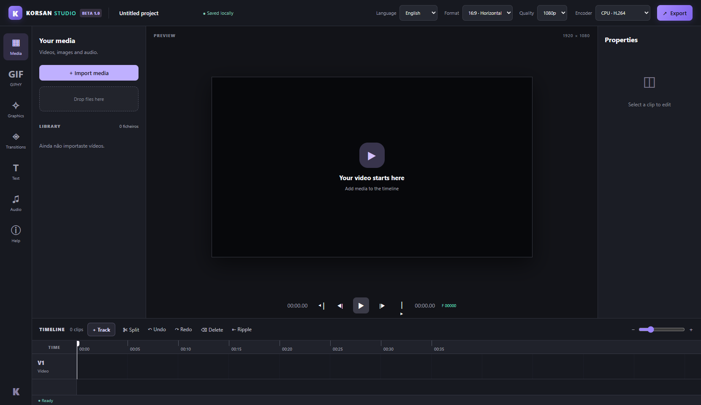

# KORSAN Studio

A local-first desktop video editor for Windows.

**Release:** v1.0.0-beta.1 — public beta for testing. Not a stable 1.0 release. KORSAN Studio is an independent project inspired by common editing workflows, not affiliated with Clipchamp, Canva, Microsoft, or CapCut.

## Features

- **Clean timeline:** starts with one video track. Audio, title and overlay lanes appear when needed; use **+ Track** to reveal another lane.
- **6 interface languages:** English by default, Portuguese (Portugal), Spanish, French, German, Italian. Selection saved locally. Some advanced dialogs and third-party text may remain in English.
- **12 transitions:** dissolve, four directional wipes, four directional slides, circle, diagonal, zoom in; duration, markers, Undo/Redo.
- **Visual editing:** image/video picture-in-picture overlay manipulation, transform keyframes, animation presets and basic image filters.
- **6 available lanes:** video V1/V2, title T1/T2, audio A1/A2, shown dynamically.
- **Multimedia:** local file imports; third-party vector logos (Simple Icons), icon assets (Lucide), original shapes; GIPHY discovery-only search with your own API key.
- **Export:** H.264/AAC MP4, 9:16 or 16:9, 720p/1080p, CPU libx264 or optional NVIDIA NVENC.
- **Local projects:** files and renders stay on the user's PC. GIPHY search alone uses an external service.

## Install on Windows

1. Download KorsanStudio-1.0.0-beta.1.exe from GitHub Releases.
2. Install FFmpeg including ffmpeg and ffprobe, available on PATH. These tools are NOT bundled with the EXE.
3. Launch the portable EXE on Windows 10 or 11 x64. Windows SmartScreen may show a warning as the build is NOT code-signed.
4. Import videos, images or audio, place them on the timeline, edit and export.

Requirements: Windows x64, FFmpeg with H.264/AAC, and sufficient free storage. NVIDIA GPU is only required for optional NVENC. No paid API is necessary for local editing.

## Build from source

Node.js 24.x and npm are recommended. In PowerShell:

    npm ci
    npm run check
    npm run desktop
    npm run package:win

Development server: node server.js (localhost port 4196). Packaged app: port 4197. App data are stored separately from source in the Electron userData directory.

## Working with transitions

Place two clips consecutively on V1, select the second and open the Transitions tab. Choose an effect and a duration between 0.1 and 3 seconds. The editor creates an overlap for the transition and shifts subsequent clips appropriately. Use the timeline marker or properties panel to edit/remove. Undo and Redo support these changes.

## Languages and timeline

The initial language is English. Choose another in the header. Your selected language is stored locally; filenames and text typed by the user are not translated.

An empty timeline shows only V1. Titles reveal T1, audio clips reveal A1, overlay clips reveal V2. Additional empty tracks remain hidden until used, or until the user opens them with + Track. Sequential video clips share V1; the editor does not create a different track for every sequential clip.

## Privacy, rights, and dependencies

- KORSAN source: MIT, see LICENSE.
- Lucide: ISC license. See its upstream repository for notices.
- Simple Icons: brand trademarks and their usage are controlled by their respective owners. Availability of a logo does not mean endorsement or unrestricted commercial permission.
- GIPHY: third-party service and its separate terms. This integration is limited to search/preview and direct external links, not downloading or embedding GIPHY GIFs in exported video without permission. API keys are session-only in the renderer.
- KORSAN does not contain Microsoft Clipchamp or Canva source or graphical assets.
- Projects, media, caches, credentials and local render folders are excluded from git by design.

## Public beta limitations

This is a beta, not a production guarantee or a feature-equivalent clone. Complex codecs, VFR video, high-volume media and very long timelines require further stress testing. Some advanced interface text is not localized in all languages. There is no auto-updater or signed binary. Review the build and external dependencies before processing sensitive media.

## Contributing and bug reports

Open a GitHub issue with reproduction steps, Windows version, input format, FFmpeg version, expected and actual behavior. Never upload private clips, personal credentials or access tokens in issues.

## Português

O KORSAN Studio é um editor de vídeo independente e gratuito para Windows. Esta versão 1.0.0-beta.1 destina-se a testes públicos; não é uma versão final estável. O inglês é o idioma inicial, mas podes selecionar português, espanhol, francês, alemão ou italiano. A timeline começa com uma única pista V1 e mostra pistas adicionais conforme necessário. Necessita de FFmpeg e FFprobe instalados.
